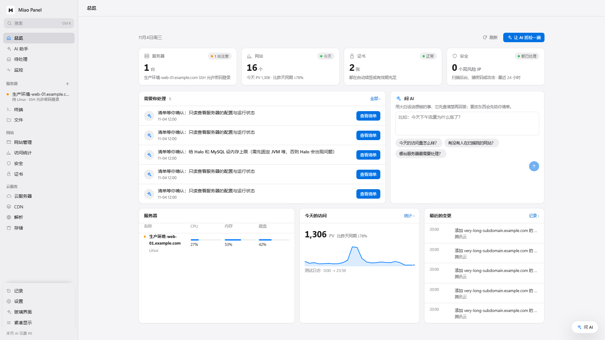
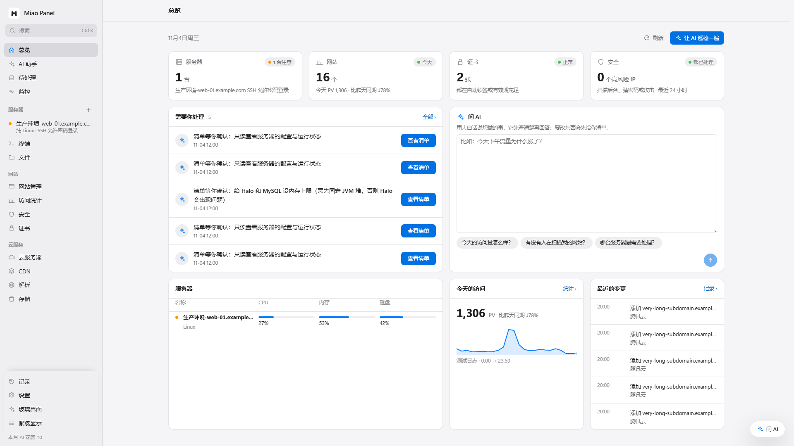
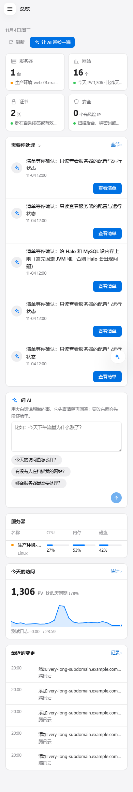

# 界面对齐修复

基于 `main` 的 `fd3fd0d4cf6f082d25fbab44bfe674dee2621609`，保留现有经典/玻璃外观及功能。

| 问题 | 修复 |
| --- | --- |
| 总览外层 page 和内部 home 重复添加边距，顶栏标题另用固定边距 | 由 page 统一提供内容宽度和边距，顶栏使用同一边界 |
| 首页各行列宽分别为 4 等分、1.6:1、1.3:1:1 | 统一为四列网格对应的整列、半宽与四分之一宽；根据实际内容宽度切换双列/单列 |
| 卡片 height:100%、自身底部 margin、行间距叠加 | 由网格负责等高和行间距；内容保持自然高度 |
| 手机侧栏被后置 position:relative 覆盖，正文出现在导航下方 | 恢复手机 fixed 抽屉定位；桌面相对定位放回基础规则 |
| 手机表单标签固定 150px，输入框只剩约 70px | 窄屏/窄内容区标签与字段上下排列；320px 下普通设置输入框为 256px |
| AI 补丁使用不存在的 .ai-panel/.ai-drawer，1100px 下正文被压到412px | 使用实际 .ai-host.panel 与共享宽度变量；1400px 起并排，其余覆盖显示 |
| 操作单元格右对齐被通用 table td 规则覆盖 | 提高操作列规则优先级，表头采用统一 ops 标记；CDN 桌面保持 table-cell |
| 320px 下统计页分段切换和待处理操作条溢出 | 分段控件内部滚动，操作条换行 |
| 紧凑模式的间距与列宽计算不一致 | 通过共享 layout-gap 同步计算；紧凑表格 padding 只应用于桌面 |
| Baize 双列内容面板在手机上被基础规则覆盖 | 窄容器内明确改为单列 |
| 按钮与筛选输入框/下拉框高度不同 | 公共控件使用 32px 高度；登录等专用大输入框保留原规则 |

## 验证

运行：安装 Playwright 后执行 `node scripts/layout_smoke.mjs /path/to/output`。
可用 `PLAYWRIGHT_MODULE` 指向已安装的 Playwright `index.mjs`。

- Chromium：1920、1440、1280、1100、1024、768、720、390、320px。
- 经典浅色，以及玻璃+紧凑+深色，共 306 个页面状态。
- 16 个主页面：总览、服务器、网站、访问统计、监控、待处理、证书、云服务器、CDN、解析、存储、终端、文件、记录、设置、AI 助手；另检查总览打开 AI 侧栏。
- 断言页面和正文不横向溢出、桌面标题与正文边距一致、同排首页卡片等高、首页共享列线、服务器表头与数据列一致、设置输入框宽度、手机菜单打开/关闭、AI 侧栏关闭。
- JavaScript 语法检查、`git diff --check`、布局检测器通过。
- 全部为本地模拟数据：首页包含长名称、长待办和 5 条变更；其余页面主要覆盖未配置/空数据状态；文件页覆盖明确的离线错误状态。没有连接生产云账号或服务器，没有验证真实服务端操作和所有弹窗。Go 后端未修改，未在本机运行完整 Go CI。

## 截图

桌面修复前：

桌面修复后：

手机修复后：

